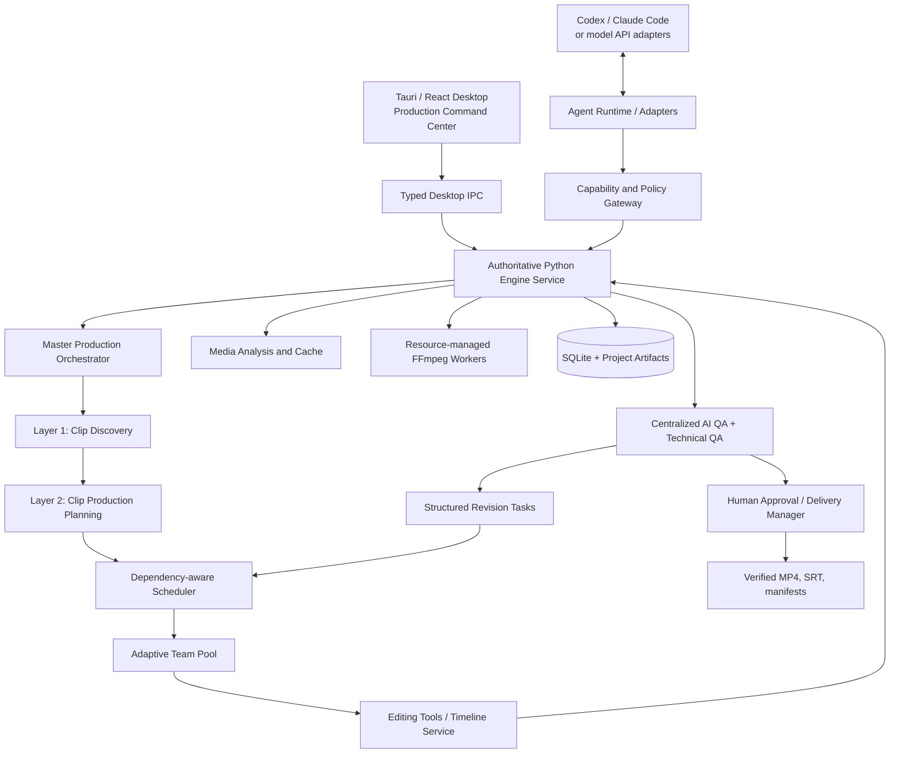
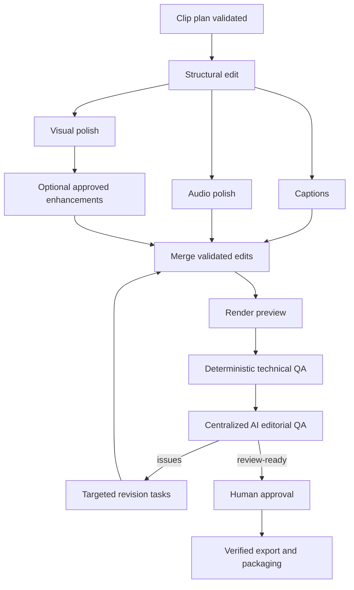

# AgenEditor 2.0 — Multi-Agent Production Architecture & Implementation Specification

> **Status:** Architecture proposal; not a claim of implemented functionality.  
> **Date:** 2026-11-17  
> **Repository:** `jordanarrivado/AgenEditor`  
> **Product direction:** Local-first, editing-only, one shared engine with multiple concurrent AI production teams.  
> **Primary platform:** Windows desktop (Tauri 2 + React/TypeScript), with a Python engine, SQLite, FFmpeg, and MCP integrations.  
> **Decision authority:** Consolidates the choices from the architecture refinement conversation. Explicit user choices override earlier recommendations.

---

## 1. Executive summary

AgenEditor 2.0 evolves the current agent-controlled video editor into a **multi-agent production studio**. A single authoritative editing engine serves multiple autonomous but scoped production teams. A Master Production Orchestrator discovers viable clips, produces structured plans, schedules work according to dependencies and resource limits, assigns tasks to adaptive agent workers, and coordinates centralized AI QA and human-approved delivery.

The primary objective is **to increase the throughput of QA-accepted videos**, especially for long-form-to-short-form repurposing and bulk client orders, **without** duplicated source analysis, uncontrolled model spending, compromised source integrity, or conflicting timeline writes.

### Non-negotiable product constraints

1. **Editing-only:** AgenEditor edits approved media and does not internally generate footage, images, voices, or music. External generation is a user-directed prompt-and-import workflow, consistent with the existing repository product rules.
2. **One authoritative engine:** UI, agent sessions, MCP, jobs, revisions, and exports read/write through the same engine service and verified contracts.
3. **Non-destructive:** Originals are immutable. Every edit is represented by a validated, versioned revision.
4. **Source-linked:** Cuts, words, captions, and overlays retain authorized asset IDs and source ranges.
5. **Local-first:** Ingest, analysis, preview, and rendering remain local by default. External AI access and any data egress must be explicitly permitted.
6. **Human-gated delivery:** AI may assemble drafts and propose approvals; final external delivery needs explicit human authorization.
7. **Truthful status:** No AI assertion alone proves that a file rendered, passed technical QA, or was delivered. The engine verifies artifacts and state transitions.
8. **Scoped concurrency:** Teams cannot mutate other clips, projects, or client context, even if they share the same engine.

---

## 2. Final architecture decisions

| ID | Topic | Final decision | Notes |
|---|---|---|---|
| D01 | Team topology | Hybrid production teams | A logical team owns one clip at a time; specialists can execute stages sequentially or in parallel if safe. |
| D02 | AI control | Hybrid AI orchestration | AgenEditor owns scheduling; adapters invoke external agent hosts and/or configured model APIs. |
| D03 | Team scaling | Adaptive team pool | Spawn/reuse logical workers according to queue depth, resources, provider limits, and budget. |
| D04 | Clip quantity | Hybrid AI discovery with user control | `auto` or user target; never fabricate clips to meet a quota. |
| D05 | Autonomy | Policy-based autonomy | Execute routine authorized work; block on missing assets or required decisions. |
| D06 | Model routing | Adaptive cost-aware router | Capability-gated, policy-compliant, budget-limited routing; deterministic tools first. |
| D07 | Coordination | Hybrid shared-context communication | Versioned shared knowledge; isolated team state; typed durable events. |
| D08 | Editing | Adaptive multi-pass workflow | Required passes plus conditional enhancements based on brief/QA. |
| D09 | QA | **Dedicated centralized AI QA** | Explicit user selection; not team self-review. Technical checks also run through the engine. |
| D10 | Scheduling | Dependency-aware adaptive scheduler | Priorities, deadlines, fair scheduling, dependencies, cost, capacity. |
| D11 | Recovery | Durable checkpointing and intelligent recovery | Task leases, idempotency, artifact verification, bounded retries. |
| D12 | Resources | Hybrid resource-aware execution | Local media/rendering by default; approved external AI; remote media workers deferred. |
| D13 | Context | Hierarchical profiles with reference intelligence | Global → client → project → clip; reference analysis and immutable snapshots. |
| D14 | Delivery | Hybrid clip approvals and batch delivery | Independently approve revisions; selectively bundle reviewed clips. |
| D15 | Operations UI | Intelligent Production Command Center | Queues, teams, QA, cost, blockers, resource telemetry, controls. |
| D16 | Development | **Complete architecture first** | Explicit user selection; design all contracts before major implementation, then test in gated phases. |
| D17 | Ownership model | Hierarchical production model | Client → Project → Batch → Clip → Task. |

The two choices marked in bold reflect explicit departures from the previously recommended alternatives; all remaining unselected decisions follow the accepted recommendations.

---

## 3. System context and architecture



**Important:** The diagram expresses logical modules, not necessarily separate OS processes. A practical initial implementation uses one authoritative engine service, subprocesses for heavy work, and bounded external AI host sessions.

### Ownership boundaries

| Component | May decide | Must not do |
|---|---|---|
| Master Orchestrator | Plans, dependencies, priorities, team allocation, escalation | Directly bypass timeline validation or approval gates |
| Deterministic Scheduler | Ready task assignment, permits, leases, retries | Invent creative plans or ignore policy |
| Agent Runtime | Execute a scoped AI task through an approved provider | Access arbitrary files, cross-client context, or unsanctioned tools |
| Production Team | Propose and commit permitted clip revisions | Overwrite another team's timeline or approve final delivery |
| Python Engine | Validate, transact, render, verify, persist | Trust agent text as evidence of completed processing |
| Centralized QA | Review source evidence and rendered drafts; issue findings | Self-approve delivery or secretly mutate editing revisions |
| Human User | Set policy, accept exceptions, approve, initiate delivery | N/A |

---

## 4. Canonical ownership and domain model

```text
Client
  └─ Project (authorized assets, briefs, project policies)
       ├─ Source Assets / Analysis Cache
       └─ Batch (production request / scheduling and delivery container)
            ├─ Clip (independent timeline, QA, approval, exports)
            │    ├─ Task / TaskAttempt / Checkpoint
            │    ├─ TimelineRevision
            │    ├─ QAReview / QAFinding
            │    └─ Approval / ExportArtifact
            └─ BatchDelivery / DeliveryManifest
```

**Definitions:**

- **Client:** Versioned client profile and permitted reference library. Clients provide an isolation boundary.
- **Project:** An authorization and asset boundary; may support multiple batches over time.
- **Batch:** A group of requested outputs with deadlines, target count, scheduling policies, and deliverable rules.
- **Clip:** Smallest independently editable, reviewed, approved, and deliverable output.
- **Task:** Smallest schedulable unit of work with declared dependencies, required capabilities, input fingerprint, and retry policy.
- **Attempt:** One leased execution of a task. Attempts are distinct from the durable task identity.
- **Checkpoint:** Verified reusable result, bound to versions/hashes of its inputs and tool settings.

### Proposed minimum relational entities

| Table | Important fields (illustrative) |
|---|---|
| `clients` | `id`, `name`, `status`, `created_at` |
| `profile_revisions` | `id`, `client_id`, `revision`, `body_json`, `content_hash`, `created_at` |
| `projects` | `id`, `client_id`, `workspace_path`, `status` |
| `project_brief_revisions` | `id`, `project_id`, `revision`, `body_json`, `content_hash` |
| `batches` | `id`, `project_id`, `target_mode`, `target_count`, `deadline`, `priority`, `status` |
| `clips` | `id`, `batch_id`, `plan_id`, `status`, `active_timeline_revision_id` |
| `clip_plans` | `id`, `clip_id`, `source_evidence_json`, `requirements_json`, `version`, `hash` |
| `tasks` | `id`, `clip_id`, `type`, `status`, `priority`, `input_fingerprint`, `attempt_count` |
| `task_dependencies` | `task_id`, `depends_on_task_id` (unique pair; no cycles) |
| `task_attempts` | `id`, `task_id`, `worker_id`, `lease_token`, `lease_expires_at`, `state`, `error_code` |
| `checkpoints` | `id`, `task_id`, `input_fingerprint`, `artifact_id`, `verified_at` |
| `workers` | `id`, `adapter_type`, `capabilities_json`, `last_heartbeat`, `status` |
| `timeline_revisions` | Existing engine revision references; linked to `clip_id` and version |
| `qa_reviews` | `id`, `clip_id`, `revision_id`, `render_artifact_id`, `reviewer`, `status` |
| `qa_findings` | `id`, `qa_review_id`, `type`, `severity`, `evidence_json`, `state` |
| `approvals` | `id`, `clip_id`, `revision_id`, `artifact_hash`, `approved_by`, `approved_at` |
| `exports` | `id`, `clip_id`, `approval_id`, `output_path`, `sha256`, `verified_at` |
| `delivery_manifests` | `id`, `batch_id`, `manifest_path`, `sha256`, `authorized_at` |
| `production_events` | `id`, `event_type`, `aggregate_id`, `sequence`, `payload_json`, `timestamp` |
| `model_usage` | `id`, `task_attempt_id`, `provider`, `model`, `tokens_in`, `tokens_out`, `cost`, `estimated` |

Use the repository's existing schema and persistence conventions where possible. These are **new proposed records**, not an instruction to create duplicate timeline, asset, or job stores.

### Schema design constraints

- Keep media on the local filesystem; store project-relative paths, hashes, metadata, and ownership in SQLite.
- Use Pydantic v2 typed contracts and generate JSON Schemas; never hand-edit generated schemas.
- Keep time values in the existing canonical integer/rational representation (no float seconds in domain logic).
- Foreign keys and unique constraints must enforce ownership and idempotency.
- Extend migrations safely; existing single-agent projects must remain readable.
- Use optimistic concurrency for timeline updates and transactional guards for task ownership.

---

## 5. AI Layer 1 — Clip discovery

### Inputs

- Approved source assets and cached transcripts/scene summaries.
- Global, client, and project instruction snapshot.
- Batch requested target: `auto` or an integer quantity.
- Duration range, platform, target audience, exclusions, and source restrictions.

### Outputs

- Candidate clips, ranked with transparent **advisory** scores.
- Every candidate includes the topic, hook, narrative completeness, source asset IDs, source ranges and transcript references, caveats, and overlap with other candidates.
- Recommended final clip count and gap between target and viable count.

### Selection rules

1. Favor self-contained, coherent ideas over arbitrary time slicing.
2. Avoid duplicate or nearly identical content unless variants are specifically requested.
3. Never add unsupported dialogue, fake citations, or filler merely to meet a requested count.
4. If evidence is insufficient, report it as a shortfall and propose review.
5. Cache immutable source analysis by source hash, analysis settings, tool version, and model version when applicable.

**Initial quality dimensions:** hook, coherence, audience relevance, clarity, visual potential, technical source condition. Weighting requires validation against human-reviewed samples.

---

## 6. AI Layer 2 — Clip production planning

Each selected clip receives an immutable, source-linked plan with:

- Narrative goal, hook, ordered cuts, timestamp/word evidence, expected duration.
- Output profile (aspect ratio, rational frame rate, dimensions, audio/caption requirements).
- Required passes (structural edit, essential polish) and conditional passes (approved B-roll, music, SFX, transitions, crop refinements).
- Missing asset requests, dependencies, allowed exceptions, client reference IDs.
- Accepted QA criteria and delivery naming profile.

Plan validation runs **before** a production team receives editing permissions. A plan that requires externally generated content stays blocked until the user has imported and approved or explicitly skipped the request, following existing AgenEditor rules.

---

## 7. Master Orchestrator and task DAG

Tasks form a validated directed acyclic graph (DAG). An illustrative clip graph:



This graph is conceptual: a real task graph is composed according to each clip's requirements. A missing enhancement task must not create a dangling dependency. Technical QA may also block AI QA on fatal technical failures.

### Task scheduling policy

- A task becomes `READY` only when dependencies are verified, required assets are approved, and authorization/budget permits execution.
- Prioritize deadline risk, explicit client priority, age/fairness, and dependency criticality.
- Allocate compatible worker capacity and resource permits separately.
- Bound number of active teams and render/analysis workers independently.
- Do not starve low-priority projects indefinitely; use queue aging or minimum-service quotas.
- Use deterministic scheduling for actual assignments; AI proposes content strategy, not database state transitions.

---

## 8. Production state machines

### Clip lifecycle

```text
DISCOVERED → PLANNED → READY → EDITING → PREVIEW_RENDERING
  → TECHNICAL_QA → EDITORIAL_QA → REVIEW_READY
  → HUMAN_APPROVED → EXPORTED → DELIVERED
```

Alternative transitions:

- `PLANNED → WAITING_FOR_ASSETS → READY`
- `EDITORIAL_QA → NEEDS_REVISION → READY` (targeted tasks only)
- Any active nonterminal stage → `BLOCKED`, `RETRY_WAIT`, or `FAILED`, depending on reason.
- `REVIEW_READY → NEEDS_REVISION` from human feedback.
- Changes to a reviewed revision invalidate downstream approval/export eligibility for the changed version.

### Task lifecycle

```text
CREATED → BLOCKED/READY → LEASED → RUNNING → SUCCEEDED
                                     ├─ RETRY_WAIT → READY
                                     ├─ CANCELLED
                                     └─ FAILED
```

A task marked `SUCCEEDED` must reference a verified output or an explicitly validated no-op result. Never infer completion from agent messages alone.

### Human approval invariant

Approval binds **exactly** to `clip_id + timeline_revision_id + validated_render_hash + export_profile_hash + applicable policy_snapshot_hash`. If any required element changes, generate a new review/approval decision.

---

## 9. Adaptive production teams and agent runtime

A **team** is a logical allocation for a clip, not necessarily five permanently running model processes. A single worker may perform several specialized stages, while independent tasks may run in parallel when merge-safe.

### Logical specialist responsibilities

- **Clip Director:** Interpret the source-linked plan and define execution steps.
- **Structural Editor:** Assemble cuts and narrative through scoped timeline tools.
- **Visual Specialist:** Captions, crop, overlays, transitions, and approved references.
- **Audio Specialist:** Dialogue integrity, normalization, music, and SFX.
- **Team Coordinator:** Merge validated proposed changes and submit a draft for central QA.

### Agent adapter interface (conceptual)

```python
class AgentRuntimeAdapter(Protocol):
    def capabilities(self) -> AgentCapabilities: ...
    async def start_task(self, assignment: ScopedTask) -> RunHandle: ...
    async def poll(self, handle: RunHandle) -> RunStatus: ...
    async def cancel(self, handle: RunHandle) -> None: ...
    async def collect_result(self, handle: RunHandle) -> AgentResult: ...
```

Implement one supported external agent adapter first, then add configured model-API adapters. Adapters are interchangeable only for tasks their **verified capabilities** support. An API-based model invocation is not automatically equivalent to a fully capable MCP agent host.

### Security and ownership rules

- Per-task scoped capability tokens, project/clip access lists, expiration, and revocation.
- Tools validate permissions **inside the engine**, not solely through prompts.
- One active timeline writer per clip, with optimistic revision checks and fencing tokens.
- No cross-client conversation history or inherited local workspace access.
- A worker released back to the pool must clear transient session context.

---

## 10. Hierarchical master instructions and reference intelligence

Instruction precedence:

```text
Engine security and provenance invariants (non-overridable)
  → Global editing defaults
  → Client profile and approved reference style
  → Project brief
  → Clip-specific creative instructions
```

Lower layers may override eligible **creative defaults**, never security, authorizations, source integrity, or explicit required client constraints. Incompatible requirements are escalated rather than silently resolved.

Each task stores a **resolved immutable context snapshot** containing versions/hashes of instructions, references, policies, selected source assets, and clip plan. A change may invalidate affected downstream checkpoints.

Reference intelligence should begin with metadata, measured audio properties, sampled shot structure, and approved style observations. Subjective AI-derived observations are labeled as estimates and should not claim the engine supports effects it cannot render.

---

## 11. AI model routing and cost control

### Decision inputs

- Task type, required modalities/tools, model/provider capability, policy allowlist.
- Provider rate limits, service availability, context length, latency characteristics.
- Estimated cost, project budget remaining, current concurrency.
- Quality benchmarks and any user-pinned provider/model.

### Routing order

1. Prefer deterministic existing engine tools when AI is unnecessary.
2. Filter models by explicit capabilities, data permissions, and policy.
3. Apply user model pins and allowed-provider limits.
4. Rank eligible options using measured quality, anticipated cost, and performance.
5. Reserve cost capacity before dispatch; reconcile actual reported usage afterwards.
6. Escalate difficult cases only under bounded retry and budget policies.

Cost figures may be estimates, particularly where third-party host subscriptions do not expose token pricing. The dashboard must distinguish **measured**, **provider-reported**, and **estimated** costs. Reaching a configured budget prevents new paid requests; already-running requests may still incur charges.

---

## 12. Centralized AI QA — explicit choice

**Centralized QA is a separate service/queue, not self-review by the editing team.** It receives an immutable rendered preview, linked timeline revision, brief snapshot, source evidence, and measurable technical QA report.

### Two complementary validations

1. **Engine technical QA:** Decodability, required codecs/format, duration, dimensions, caption/source time integrity, audio measurement, media hashes, and approved asset usage.
2. **Independent AI editorial QA:** Hook, narrative coherence, framing, pacing, reference alignment, and appropriate use of B-roll based on actual available evidence.

AI editorial QA produces typed findings: `severity`, `category`, `asset_or_timeline_reference`, `evidence`, `suggested_correction`, `confidence`, and `review_revision_id`.

A centralized QA worker **may not** secretly rewrite an approved clip. It issues revision tasks to production workers. Retry loops have a bounded maximum (initially two targeted attempts per finding); unresolved cases move to human review.

The QA worker pool scales separately from editing teams, to avoid a permanent bottleneck. AI scoring does not equal human final approval.

---

## 13. Durable checkpointing and recovery

### Checkpoint boundaries

Asset analysis → candidate discovery → validated clip plan → each committed edit pass → verified preview → technical QA → editorial QA → human approval → verified export.

Each checkpoint stores:

- Task ID and attempt ID.
- Input fingerprint: source hashes, instruction/reference versions, configuration, code/schema version, relevant prior revision IDs.
- Verified artifact ID, path, hash, and validation outcome.
- Completion timestamp and reuse eligibility.

### Lease and recovery rules

- A worker acquires an expiring lease transactionally and periodically heartbeats.
- Each lease carries a monotonically advancing **fencing token**; expired workers cannot commit later.
- On process/service restart, reconcile live processes, committed artifacts, unacknowledged results, and expired leases.
- Retry transient errors with bounded exponential backoff and jitter; do not retry permanent policy/schema errors automatically.
- Reuse valid analysis and completed edit stages; restart non-resumable FFmpeg or model requests only after reconciliation.
- Invalidate dependent checkpoints if their verified input fingerprints change.
- Preserve diagnostic events without logging secrets or excessive source material.

**Do not promise exactly-once remote model execution.** Enforce idempotency on local committed state, and reconcile remote uncertainty to reduce duplicate charges when possible.

---

## 14. Resource-aware execution

Use **independent semaphores/permits** for:

- AI teams and provider requests.
- Heavy transcription/scene analysis.
- FFmpeg preview and final rendering.
- Optional hardware encoder use.

Suggested conservative initial configuration (not measured): 2 AI team slots, 1 heavy analysis slot, 1 render slot, 1 centralized QA worker. Tune through actual benchmarks and hardware discovery.

Local processing remains the default. Approved remote AI may receive only the minimum authorized context. Remote rendering/media transfer is a future capability requiring explicit design for encryption, transfer, billing, retention, and worker authentication.

Record CPU/memory/disk utilization and per-stage time. Optimize **QA-approved clips per hour**, not raw concurrent process count.

---

## 15. Hybrid approval and batch delivery

- Each clip can enter `REVIEW_READY` independently.
- A user can approve an exact revision and artifact individually or perform deliberate bulk approval for an enumerated reviewed set.
- Partial batch delivery is supported only if the project's client delivery rules permit it.
- Export to a staging location, verify file integrity and manifest, then atomically publish where possible.
- Delivery package can include MP4, SRT, QA/known-issues report, revision manifest, and hashes.
- Editable project snapshots are metadata/references unless an explicit full-media package is requested.
- No client upload or notification occurs without user authorization.

Proposed structure:

```text
Client_Project_Batch_001/
  videos/
    Client_Clip_01.mp4
    Client_Clip_02.mp4
  captions/
    Client_Clip_01.srt
    Client_Clip_02.srt
  reports/
    qa_report.json
    known_issues.json
    delivery_manifest.json
  project/
    revision_manifest.json
    project_snapshot.json
```

---

## 16. Production Command Center

The desktop UI should present **one cohesive Production workspace**, rather than many redundant navigation tabs.

### Essential views

| View | Essential information and actions |
|---|---|
| Overview | Batch progress, queue counts, approved outputs, urgent blockers |
| Queue | Task DAG, priority, dependency reasons, assignments, pause/resume/retry |
| Teams | Active agent adapter, scoped clip, state, duration, retry count |
| Review | Centralized QA findings, playback, human approval, revision requests |
| Resources | AI requests, render permits, CPU/RAM/disk pressure, rate limits |
| Costs | Measured vs. estimated usage by project, provider, and task |
| Delivery | Approved clip selection, manifests, export verification and history |

### Observability rules

- Engine-recorded events and artifacts are authoritative; AI text is diagnostic only.
- Show explicit states for `WAITING_FOR_ASSETS`, `RETRY_WAIT`, `NEEDS_HUMAN`, `FAILED` and blocked budget.
- Show timestamps, stage duration, and queue wait separately; avoid fabricated percentage progress.
- Project-level cancellation and pause must be safe and transactional.
- Avoid storing raw user transcripts, model credentials, or private paths in general-purpose analytics logs.

---

## 17. Suggested typed API and MCP contracts

These are proposed names and examples; adapt to existing tool naming and security patterns before implementation.

### Domain contracts

- `BatchCreateRequest`, `BatchPolicy`, `ClipCandidate`, `ClipPlan`, `ClipTaskGraph`.
- `ScopedTask`, `TaskAttempt`, `WorkerLease`, `ExecutionPermit`.
- `ContextSnapshot`, `ModelRoutingDecision`, `CostReservation`.
- `CheckpointDescriptor`, `QAReview`, `QAFinding`, `ClipApproval`, `DeliveryManifest`.

### Service operations

| Operation | Main behavior |
|---|---|
| `batch.create` | Create batch and bind project/client policy snapshot |
| `batch.discover_clips` | Start source-linked clip discovery task |
| `batch.confirm_selection` | Lock selected candidates and create clip plans |
| `production.plan` | Build/validate clip task graph |
| `production.start` | Schedule ready tasks under budget and policy |
| `production.pause/resume/cancel` | Update durable scheduler state |
| `production.status` | Return per-clip/team/worker aggregate state |
| `task.lease/heartbeat/complete/fail` | Internal privileged worker APIs |
| `qa.review` | Queue independent editorial review of pinned artifact |
| `qa.submit_findings` | Persist structured evidence and revision tasks |
| `approval.approve` | Record human approval for an exact revision + artifact |
| `delivery.package` | Stage, verify, and publish selected approved clips |

Not all operations should be publicly available over MCP. **Worker lease, approval, and privileged engine administration must use trusted internal or human-authorized endpoints**, never arbitrary model calls. Keep existing MCP editing tools as limited, validated capabilities.

---

## 18. Proposed repository organization

Use the existing paths rather than creating a second engine:

```text
packages/ageneditor/
  contracts/                  # Existing Pydantic contracts; extend + regenerate schemas
  orchestration/              # Proposed modules (create as implemented)
    orchestrator.py
    scheduler.py
    task_graph.py
    team_manager.py
    agent_runtime.py
    model_router.py
    checkpoint_service.py
    resource_manager.py
    event_dispatcher.py
  production/
    batch_service.py
    clip_discovery.py
    clip_planner.py
    context_resolver.py
    delivery_service.py
  quality/
    editorial_review.py
    revision_router.py
  ...                         # Existing asset, timeline, job, render, MCP services retained
apps/desktop/src/
  features/production/        # Command Center views
  services/                   # Typed IPC integration
schemas/                      # Generated, not hand-edited
 tests/                       # Unit, integration, concurrency, recovery, E2E
 docs/                        # Architecture and operating notes
```

**Repository compatibility:** Existing documented stack includes Python 3.12, Pydantic, SQLite, FFmpeg, faster-whisper, MCP, Tauri 2, React/TypeScript, and a shared engine sidecar. The implementation must confirm current filenames/classes and reuse existing services. Do not create empty placeholder modules in contradiction of `AGENTS.md`.

---

## 19. Architecture-first engineering plan

The complete design is specified before major code changes, as selected. Delivery remains staged and tested to control integration risk.

### Design gate A — Architecture baseline

- Map current engine service/API boundaries and inventory gaps.
- Define entity ownership, schema migrations, invariants, and compatibility policy.
- Define typed task, event, worker, model, QA, approval, and delivery contracts.
- Produce a threat model for concurrent MCP clients, scoped tokens, and cross-client isolation.
- Review proposed architecture against repository `AGENTS.md`, product spec, and limitations.

**Exit:** Contracts and boundaries approved; no unresolved ownership ambiguities.

### Implementation gate B — Multi-clip data foundation

- Persist batches, clips, tasks, dependencies, context snapshots.
- Share cached asset analysis and source references.
- Prove separate clip revision histories for one input source.

**Exit:** A source can produce three independently planned clip jobs with valid evidence.

### Implementation gate C — Two-team orchestration

- Implement durable scheduler, trusted leases, worker adapters, and scoped capabilities.
- Run two different clip tasks concurrently through the same engine.
- Guard revision commits against stale/cross-clip writers.

**Exit:** Concurrency test shows isolated outputs and no conflicting writes.

### Implementation gate D — Recovery and capacity

- Add checkpoints, reconciliation, retry classification, resource semaphores, and budget reservations.
- Test disconnects, restarts, renderer failures, duplicate messages, and rate limits.

**Exit:** Completed checkpoints are reused and failed tasks recover without duplicate committed outputs.

### Implementation gate E — Centralized QA and delivery

- Implement pinned preview QA, dedicated reviewer queue, structured findings, targeted revisions, human approval, and verified batch export.

**Exit:** QA failures requeue only affected work; approval is tied to exact reviewed artifacts.

### Implementation gate F — Desktop command center and user trials

- Add live queue/team views, resource and cost diagnostics, exception controls, reviews, and delivery.
- Conduct consented real-footage evaluations and Windows clean-machine acceptance tests.

**Exit:** A user can manage the complete multi-clip workflow in the native app without manual database operations.

---

## 20. Acceptance test matrix

| Test | Pass condition |
|---|---|
| Discovery integrity | All proposed source ranges resolve to registered assets; no invented dialogue |
| Three clips, two teams | Two teams operate concurrently; third waits; independent revisions are preserved |
| Duplicate analysis | Same source/config reuses verified cached transcript/metadata |
| Client isolation | No agent/task can read or modify another client's unauthorized assets/context |
| Concurrency fencing | Stale worker cannot commit after lease expiry/reassignment |
| Dependency block | Task requiring unapproved asset does not execute; unrelated ready tasks continue |
| Provider rate limit | Only affected tasks enter retry wait; rate-limit instructions respected |
| Engine restart | Valid checkpoints and immutable revisions survive; tasks reconcile safely |
| Crash during render | Partial render not marked complete; verified output retried or resumed appropriately |
| Model budget | New paid calls stop when budget is exhausted; measured/estimated charges labeled |
| QA independence | Dedicated reviewer receives pinned artifact and cannot mutate draft directly |
| QA revision | Structured finding generates bounded targeted revision with dependent rechecks |
| Approval pinning | Changing revision/artifact invalidates approval eligibility for new version |
| Partial delivery | Only enumerated approved clips are packaged and verified |
| Existing workflow | Legacy single-agent project editing remains functional |
| Hardware benchmark | Report clips/hour, CPU/RAM pressure, average queue wait, cost/approved clip |
| Desktop E2E | Queue, pause/resume, QA, approval, export, and blocked-state controls work |

### Minimum reference workflow

`1 source → 3 viable source-linked clips → 2 parallel teams → isolated timeline revisions → resource-controlled rendering → centralized AI QA → deliberate human approval → verified partial or full batch package`.

### Measurable success indicators

- **Primary:** Human-approved, technically valid videos per hour at a defined hardware and source workload.
- **Secondary:** Time from ingest to first reviewable clip, queue wait, cost per approved clip, revision rate, checkpoint reuse, crash recovery success, and cross-client security test outcomes.
- Compare against the existing single-agent workflow using the same input media, approved templates, model budget, hardware, and quality criteria. Do not assert speedup before measurement.

---

## 21. Risks, limits, and deferred features

| Risk | Mitigation |
|---|---|
| More agents do not mean faster encoding | Separate render pool and benchmark-based concurrency |
| Unbounded AI costs | Provider capability allowlists, cost reservations, budget gates |
| Context leakage | Client/project scoped access, immutable snapshots, wiped worker sessions |
| Lost or duplicate work after crash | Transactional task leases, fencing, idempotent commits, reconciliation |
| AI-generated QA false confidence | Source- and render-evidenced findings, technical QA, final human approval |
| Stale edit plans | Source hash and policy fingerprint invalidation |
| Too many new UI tabs | One cohesive Production workspace with focused subviews |
| Complex integration rewrite | Preserve one shared engine; architecture-first design with gated changes |

**Deferred until measured need:** remote FFmpeg farm, full cloud media hosting, unlimited worker scaling, automatic model benchmarking, sophisticated AI reference understanding, and advanced NLE effects beyond current supported engine capabilities.

**Existing documented limitations to verify before release:** consented real-video QA dataset, clean Windows installation acceptance, real multi-host editing sessions, hardware benchmarks, and any remaining release/license gates. Refer to the current `KNOWN_LIMITATIONS.md` and repository roadmap for authoritative status.

---

## 22. Implementation start checklist

- [ ] Create a dedicated `ageneditor-2.0` development branch (after explicit implementation authorization).
- [ ] Inspect current contracts, service modules, migrations, MCP tools, and desktop IPC endpoints.
- [ ] Write migration/compatibility plan for existing projects.
- [ ] Approve domain, task/event, and scoped-agent API contracts.
- [ ] Approve security threat model and human authorization boundaries.
- [ ] Define checkpoint fingerprints and failure classification.
- [ ] Define integration fixtures and the three-clip/two-team benchmark.
- [ ] Implement in gated milestones with tests and documentation updates.
- [ ] Benchmark real footage and verify quality before claiming bulk-production performance.

---

## 23. Definition of AgenEditor 2.0 MVP success

A Windows desktop user can import authorized footage, apply versioned client and project instructions, discover or request multiple viable clips, produce validated clip plans, run at least **two concurrent scoped AI production teams** through the **one shared editing engine**, recover interrupted tasks, submit immutable drafts to **centralized independent AI QA**, approve selected revisions, and export verified partial or complete batches without modifying source assets or leaking cross-client context.

The architecture may support more teams and providers, but measured and verified two-team production is the initial operational proof.

---

*Document prepared from the AgenEditor architecture decisions in this conversation and the previously reviewed repository documentation. All 2.0 components are proposals until verified as implemented. This file itself does not modify GitHub.*
